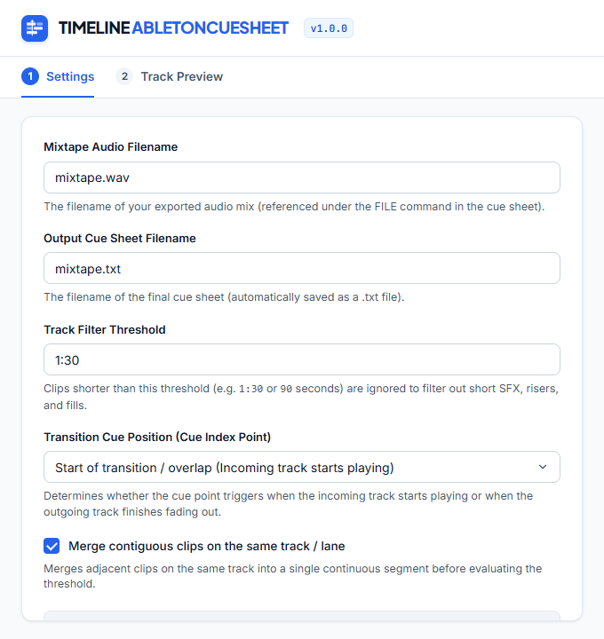

# Timeline AbletonCueSheet

**Timeline AbletonCueSheet** is a professional Ableton Live extension built with the `@ableton-extensions/sdk`, designed to generate ready-to-use cue sheets (`.cue` / `.txt`) directly from your Ableton Live arrangement for mixtapes, podcasts, and live sets.

---

## 📸 Interface Preview



---

## 🤖 Overview & Purpose

Normally, DJs and producers have to manually scrub through their arrangement to note the exact timecode (minutes, seconds, frames) of each transition to create a tracklist or CUE file.

**Timeline AbletonCueSheet**:
1. Launches directly from Ableton Live's right-click context menu on clips or tracks (**"Timeline AbletonCueSheet..."**).
2. Automatically parses all audio and MIDI clips from the active arrangement.
3. Applies intelligent threshold filters to ignore transition risers, sweeps, fills, and short percussion samples.
4. Seamlessly merges consecutive contiguous clips on the same track.
5. Provides a clean, focused dialog where you can review, edit, and adjust track titles and performers.
6. Generates the final CUE sheet directly to your desktop or copies it to your clipboard with one click.

---

## 🎛️ Settings & Workflow

### Screen 1: Settings
1. **Mixtape Audio Filename**: The name of your exported mix audio file (e.g., `mixtape.wav`), referenced under the `FILE` command in the cue sheet.
2. **Output Cue Sheet Filename**: The name of the text file saved to your desktop (automatically synchronized with the audio filename as `.txt`).
3. **Track Filter Threshold**: Clips shorter than this duration (e.g., `1:30` or `90` seconds) are ignored so short FX, risers, and fills do not generate spurious tracks.
4. **Transition Cue Position (Cue Index Point)**:
   - *Start of transition / overlap*: The track cue triggers when the incoming track begins playing.
   - *End of transition / overlap*: The track cue triggers when the outgoing track finishes fading out.
5. **Merge contiguous clips on the same track / lane**: Merges adjacent clips on the same track into a single continuous musical segment before evaluating the threshold.

### Screen 2: Track Preview & Editing
- **Interactive Track Table**: Real-time preview with editable song titles and artist/performer fields.
- **Live CUE Code Preview**: Real-time syntax-formatted display of the structured CUE sheet.
- **Copy to Clipboard**: Copies the generated CUE text directly to your clipboard.
- **Save to Desktop**: Instantly writes the cue sheet text file directly to your desktop.

---

## 🏗️ Architecture & Dataflow (Developers & Agents)

The extension operates as a hybrid Node.js / Webview application via the `@ableton-extensions/sdk`:

```
┌────────────────────────────────────────────────────────────────────────┐
│ Ableton Live 12 (Arrangement View)                                     │
└───────────────────────────────────┬────────────────────────────────────┘
                                    │ 1. context.application.song
                                    ▼
┌────────────────────────────────────────────────────────────────────────┐
│ src/ableton-cuesheet/extension.ts (Node.js Extension Host runtime)     │
│ - Collects song.tempo and song.tracks.arrangementClips                 │
│ - Resolves filenames via AudioClip.filePath                            │
│ - Dynamically injects JSON via <script>const projectData = ...         │
│ - Calls context.ui.showModalDialog(dataUrl, 680, 720)                  │
└───────────────────────────────────┬────────────────────────────────────┘
                                    │ 2. Data URL Modal Dialog
                                    ▼
┌────────────────────────────────────────────────────────────────────────┐
│ src/ableton-cuesheet/ui/interface.html (Webview UI)                    │
│ - Styled with @timeline-studio/design-system                           │
│ - Filters short samples/risers based on threshold                      │
│ - Merges contiguous clips on the same lane                             │
│ - Converts beats to MM:SS:FF timecodes based on song tempo             │
│ - Returns JSON payload via window.close(JSON.stringify(result))        │
└───────────────────────────────────┬────────────────────────────────────┘
                                    │ 3. Promise resolve in extension.ts
                                    ▼
┌────────────────────────────────────────────────────────────────────────┐
│ extension.ts -> Writes file directly to user Desktop                   │
└────────────────────────────────────────────────────────────────────────┘
```

### Key Files:
- `manifest.json`: Defines extension metadata (`name`, entry point `dist/extension.js`, and API version).
- `build.ts`: Esbuild bundler script. Note that `interface.html` is inlined as a text string into `dist/extension.js`.
- `vendor/`: Bundles the local `.tgz` packages (`ableton-extensions-sdk` and `ableton-extensions-cli`) so `npm install` works without needing private Ableton registry accounts.
- `DESIGN.md`: Complete design system specifications, tokens, typography, and window layout rules.
- `screenshot.png`: Exact rendered screenshot (680×720) of the modal dialog.

---

## 🚀 Installation & Development

### Requirements
- Node.js (version 24.14.1 or higher)
- Ableton Live 12+ (required for live testing with `npm start`; **not** required to build the `.ablx` package!)

### Setup
```sh
npm install
```

### Building the `.ablx` Package
To build and package the extension for Ableton Live:
```sh
npm run package
```
This runs `tsc --noEmit`, builds the production bundle with `build.ts`, and executes `extensions-cli package`. The resulting package is `ableton-cuesheet-1.0.0.ablx` in the project root.

### Installing in Ableton Live
- **Method 1**: Double-click `ableton-cuesheet-1.0.0.ablx`. Ableton Live 12 will open and install the extension automatically.
- **Method 2**: Drag and drop the file directly into the active Ableton Live window.
- Once installed, right-click any audio clip, MIDI clip, or track in Live 12 to find **"Timeline AbletonCueSheet..."**.

### Local Development & Live Debugging
1. Copy `.env.example` to `.env`:
   ```sh
   cp .env.example .env
   ```
2. Verify `EXTENSION_HOST_PATH` in `.env` points to your `Ableton Live 12 Suite.exe`.
3. Launch the extension inside Live's Extension Host:
   ```sh
   npm start
   ```

### NPM Scripts
- `npm run build`: Bundles the production script into `dist/extension.js`.
- `npm run build:dev`: Bundles in dev mode with source maps.
- `npm run package`: Builds and packages the extension into an `.ablx` file.
- `npm start`: Compiles and runs the extension directly within Live's Extension Host.

---

## 📄 License
MIT &bull; Created for the music community.
